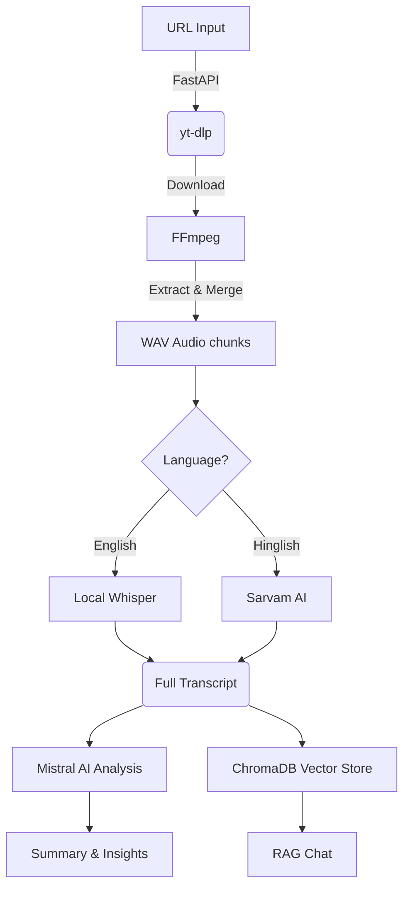

# Sabha-AI


**"AI-Powered Meeting Intelligence"**

Sabha-AI is an end-to-end meeting intelligence platform. It processes online media (such as YouTube videos or yt-dlp-compatible links), extracts the audio, transcribes the speech, summarizes the content, extracts key insights (action items, decisions, and open questions), and allows you to chat directly with the meeting using Retrieval-Augmented Generation (RAG).

## 🚀 Key Features

- **Media Ingestion**: Supports YouTube and other yt-dlp-compatible URLs.
- **Dual Transcription Engine**: 
  - English: Uses a local instance of OpenAI's **Whisper**.
  - Hindi/Hinglish: Uses **Sarvam AI** for high-quality speech-to-text translation.
- **Intelligent Summarization & Extraction**: Powered by **Mistral AI**, it generates concise summaries, action items (with task, owner, and deadline), key decisions, and open questions.
- **RAG Meeting Chat**: Uses **ChromaDB** and HuggingFace embeddings to enable conversational Q&A over the entire meeting transcript.
- **Exporting**: Generate professional PDF or TXT reports of your meeting intelligence.
- **Modern UI**: A premium, dark-themed React + Vite SaaS frontend.

## 🏗 Architecture & Processing Pipeline

The pipeline is entirely asynchronous and non-blocking:



## 🛠 Tech Stack

- **Frontend**: React, Vite, Tailwind CSS, Framer Motion
- **Backend**: FastAPI, Python, Uvicorn
- **AI/ML Pipelines**: LangChain
- **Media Processing**: yt-dlp, FFmpeg, pydub
- **Models**:
  - Transcription: Whisper, Sarvam AI
  - Embeddings: HuggingFace (sentence-transformers)
  - Intelligence / LLM: Mistral AI API

## 📂 Project Structure

```
Sabha-AI/
├── backend/            # FastAPI routers, schemas, and job store
├── core/               # AI core modules (extractor, rag_engine, summarize, transcriber, vector_store)
├── frontend/           # React + Vite UI codebase
├── utils/              # Audio processor and yt-dlp handling
├── .env                # Environment configuration
├── requirements.txt    # Python dependencies
└── README.md           # Documentation
```

## ⚙️ Prerequisites

Before you begin, ensure you have met the following requirements:
- **Python 3.10+** (Tested on Python 3.13)
- **Node.js 18+** & **npm**
- **FFmpeg**: You **MUST** have FFmpeg installed and available on your system `PATH` for yt-dlp and Whisper to extract and process audio chunks.

## 📦 Installation

1. **Clone the repository:**
   ```bash
   git clone https://github.com/Rysin09/Sabha-AI.git
   cd Sabha-AI
   ```

2. **Backend Setup:**
   Create a virtual environment and install the dependencies:
   ```bash
   python -m venv .venv
   
   # Windows
   .\.venv\Scripts\activate
   # Linux/Mac
   source .venv/bin/activate
   
   pip install -r requirements.txt
   ```

3. **Frontend Setup:**
   ```bash
   cd frontend
   npm install
   ```

## 🔑 Environment Variables

Create a `.env` file in the root of the project with the following variables. **Do not commit this file to version control.**

```env
# AI API Keys
MISTRAL_API_KEY=your_mistral_api_key_here
SARVAM_API_KEY=your_sarvam_api_key_here

# Model Configurations
MISTRAL_MODEL=mistral-large-latest
WHISPER_MODEL=small
SARVAM_STT_MODEL=saaras:v2.5

# Embeddings
EMBEDDING_DEVICE=cpu # Set to 'cuda' if you have a compatible NVIDIA GPU

# Storage settings
UPLOAD_DIR=uploads
VECTOR_DB_DIR=vector_db
MAX_UPLOAD_SIZE_MB=500
```

## 🏃 Running the Application

You will need two terminal windows to run both the backend and frontend development servers.

**Terminal 1 (FastAPI Backend):**
```bash
# Ensure your virtual environment is active
uvicorn backend.main:app --reload --port 8000
```

**Terminal 2 (React Frontend):**
```bash
cd frontend
npm run dev
```

Visit `http://localhost:5173` in your browser. The interactive Swagger API documentation is available at `http://localhost:8000/docs`.

## 💡 How to Use

1. **Submit a Meeting**: Paste a valid YouTube URL (or other yt-dlp compatible URL) into the input field.
2. **Select Language**: Choose either English (uses Whisper) or Hindi/Hinglish (uses Sarvam AI).
3. **Wait for Processing**: The system will download the audio, transcribe it, summarize it, and index it into the vector database.
4. **Dashboard**: View the generated summary, action items, and key decisions.
5. **Chat**: Use the chat panel to ask specific questions about the meeting (e.g., "What did John say about the Q3 roadmap?").
6. **Export**: Download the insights as a PDF or TXT report.

## 🛑 Limitations
- The application heavily relies on FFmpeg being correctly configured on your `PATH`.
- Local file uploads are intentionally disabled in this MVP; only URL processing is supported.
- YouTube may block yt-dlp extraction for videos requiring a JS runtime or age verification.

## 🤝 Contributing
Contributions, issues, and feature requests are welcome! Feel free to check the issues page.

## 📝 License
This project is licensed under the MIT License.
